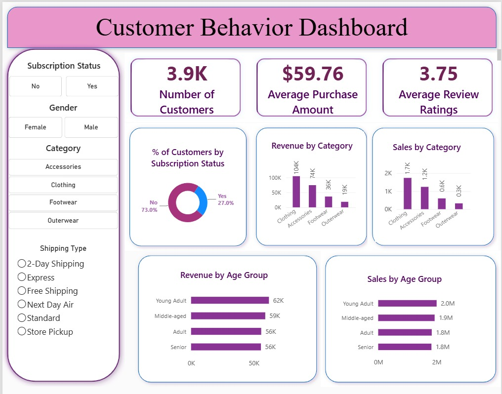

# Customer Sales Analysis
An end-to-end customer shopping behaviour analysis using SQL, Python (Jupyter Notebook), and Power BI. The project examines purchase amounts, product categories, subscription status, reviews, discounts, shipping types, previous purchases, and age-group patterns.

Tools: MySQL · SQL · Python · Pandas · Jupyter Notebook · Power BI

Quick links: [Full report (PDF)](Customer_Sales_Analysis_Report.pdf) · [Customer Behavior Dashboard](Customer_Behavior_Dashboard.pbix) · [Python notebook](EDA.ipynb) · [SQL queries](SQL_Queries.sql)
Business problem
A retail business needs a concise view of customer shopping behaviour to understand which categories contribute the most revenue, how subscription status is distributed, and how purchase patterns vary across customer groups. The source data contains row-level customer and purchase attributes; SQL summaries and a Power BI dashboard make the patterns easier to explore.
Key numbers
Measure	Value
Customer records	3,900
Average purchase amount	$59.76
Average review rating	3.75 / 5
Subscribers	27.0%
Non-subscribers	73.0%

The first three values are supported by the uploaded notebook output and dashboard. Subscription shares are transcribed from the dashboard screenshot. Category chart labels below are rounded visual values and should be reconciled with the editable Power BI model before being treated as exact.

## Key findings
- Clothing leads the displayed category revenue chart: approximately 104K, followed by Accessories at 74K, Footwear at 36K, and Outerwear at 19K.
- The average purchase amount is about $59.76: the notebook summary reports a mean of $59.764 and a median of $60, with observed purchase amounts between $20 and $100.
- Subscription status is imbalanced in the dashboard: 27% Yes versus 73% No. This provides a useful baseline for customer segmentation, but does not show that subscription causes higher spending.
- Age-group revenue is relatively close in the displayed chart: Young Adult is approximately 62K, Middle-aged 59K, and Adult and Senior about 56K each.
- Review ratings required cleaning: the notebook reports 37 missing ratings and fills them with the median rating for each category.
- SQL explores customer and product questions: queries include above-average spenders using discounts, product ratings, shipping comparisons, customer segments, discount rates, product rankings within category, repeat-buyer subscription status, and revenue by age group.
## Recommendations
1. Validate category performance against SQL and the Power BI data model before making inventory or marketing decisions.
2. Compare subscriber and non-subscriber purchase amounts, frequency, and repeat-purchase behaviour; treat observed associations as non-causal.
3. Measure discount usage by product and evaluate its relationship with repeat purchases. Add cost and margin data before judging discount effectiveness.
4. Use purchase-history segments to shape retention tests, after confirming the definitions for New, Returning, and Loyal customers.
5. Track data quality and reconcile all dashboard KPIs with documented SQL aggregations before publishing final business claims.
   
## Approach
1. Inspect: loaded the CSV into Pandas and reviewed columns, data types, descriptive statistics, and missing values.
2. Clean: imputed missing review ratings using the median within each product category, standardised column names, and renamed the purchase amount field.
3. Engineer features: created quantile-based age groups and mapped purchase-frequency labels to approximate day counts.
4. Load to MySQL: wrote the processed DataFrame to the customer table in the customer_shopping_da4 database using SQLAlchemy and the MySQL connector.
5. Query: wrote SQL for revenue summaries, discount analysis, product ratings, shipping comparisons, customer segments, category rankings, and age-group revenue.
6. Visualise: created the supplied Power BI dashboard with KPI cards, slicers, and category and age-group charts.
   
## Dataset and quality notes
- The notebook contains 3,900 records and customer-shopping attributes including age, gender, item purchased, category, purchase amount, location, season, review rating, subscription status, shipping type, discount applied, previous purchases, payment method, and purchase frequency.
- The notebook reports 37 missing review ratings. These are imputed using the category median; the resulting rating column has zero missing values.
- The notebook checks that discount_applied and promo_code_used match for all rows, then drops promo_code_used.
- The raw CSV and editable Power BI .pbix file were not included with the materials used to prepare this report. Dashboard chart values beyond the headline KPIs are therefore quoted as rounded screenshot labels, not independently re-computed results.
  
## Repository contents
File	Description
[`Customer_Sales_Analysis_Report.pdf`](Customer_Sales_Analysis_Report.pdf)	Project report with dashboard screenshot, methodology, findings, recommendations, and limitations
[`EDA.ipynb`](EDA.ipynb)	Python notebook for data inspection, cleaning, feature engineering, and loading data into MySQL
[`SQL_Queries.sql`](SQL_Queries.sql)	SQL business questions and analytical queries
[`Customer_Behavior_Dashboard.pbix`](Customer_Behavior_Dashboard.pbix) PowerBI file of Analysis Dashboard
[`DashboardScreenshot.jpeg`](DashboardScreenshot.jpeg)	Screenshot of the Power BI dashboard

## How to reproduce
1. Place the source CSV in the working directory and update the path in EDA.ipynb if needed.
2. Install the Python dependencies used by the notebook, including pandas, SQLAlchemy, and mysql-connector-python.
3. Create the MySQL database and configure a local database user.
4. Update the connection configuration securely, then run the notebook to prepare and load the customer table.
5. Open SQL_Queries.sql in a MySQL client and execute the queries against the loaded table.
6. Open the Power BI project file, connect it to the appropriate source, and refresh the model. The .pbix file was not included in the supplied materials.
   
## Limitations and implementation notes
- Sensitive credentials: the uploaded notebook contains a hard-coded database password. Do not commit real credentials to GitHub. Use environment variables or a local .env file excluded by .gitignore; rotate the credential if it is real.
- SQL alias issue: query 5 currently uses AVG(purchase_amount) for both avg_spend and total_revenue. Replace the second expression with SUM(purchase_amount) before interpreting it as total revenue.
- Customer segment definition: the SQL currently labels previous_purchases = 1 as New. If zero previous purchases are possible, revise the rule to match the intended business definition.
- The dataset contains no cost or margin fields in the uploaded notebook, so the analysis describes purchase amounts/revenue rather than profitability.
- Dashboard values are descriptive and do not establish causation.

  
Author: Abhijit Sharma
